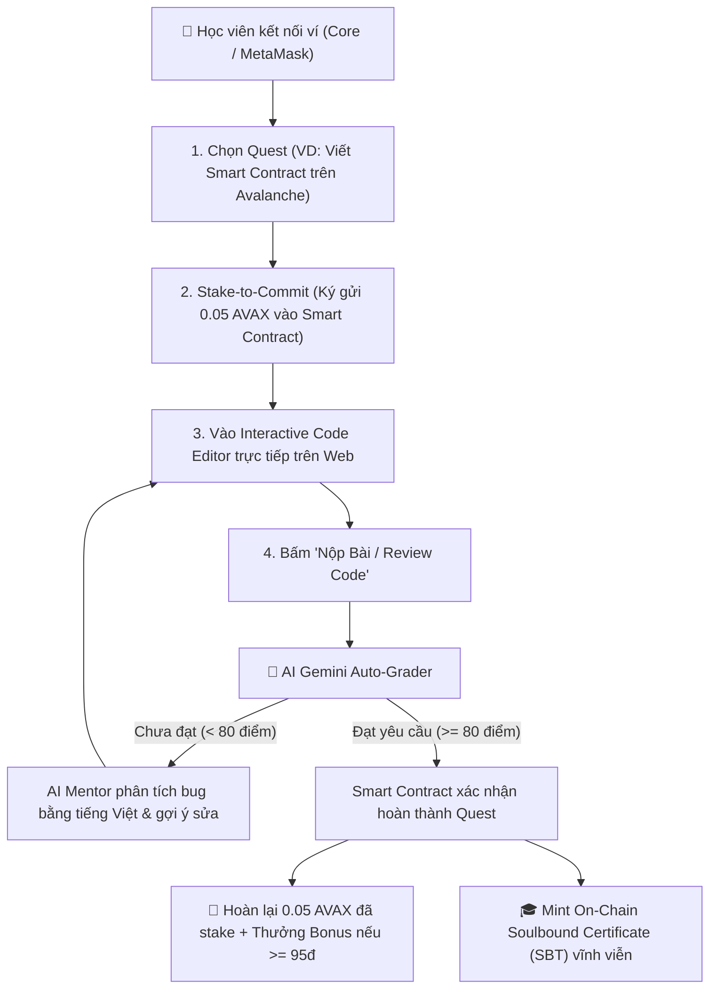
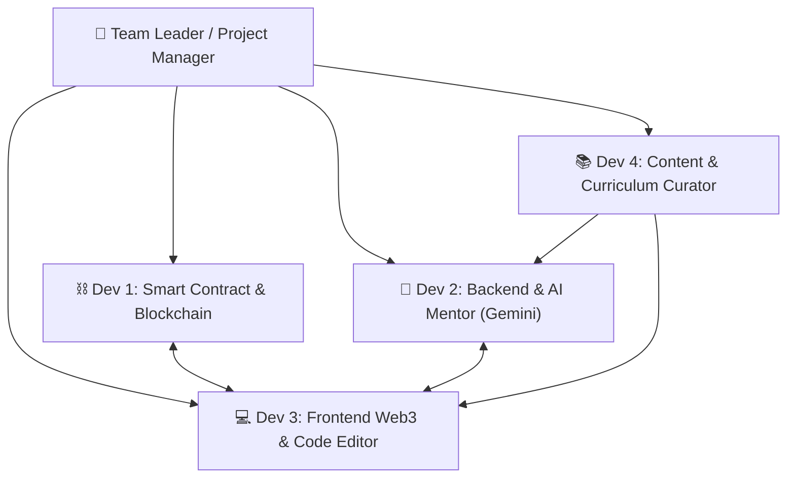

# 📋 BẢN KẾ HOẠCH & PHÂN CÔNG NHIỆM VỤ DỰ ÁN
# CodeQuestAvax — Web3 & AI Interactive Developer Academy

> **Slogan:** Học lập trình tương tác • Cam kết bằng Smart Contract • AI Gemini chấm bài & Mentor • Mint chứng chỉ Soulbound (SBT) trên Avalanche Fuji.

---

## 🏛️ 1. TỔNG QUAN DỰ ÁN & VÒNG LẶP SẢN PHẨM



---

## 👥 2. PHÂN CHIA VAI TRÒ & NHIỆM VỤ CHI TIẾT (ASSIGNMENT)



---

### ⛓️ VAI TRÒ 1: BLOCKCHAIN & SMART CONTRACT DEVELOPER
- **Mục tiêu:** Xây dựng, kiểm thử và triển khai các Smart Contract trên mạng **Avalanche Fuji C-Chain**.
- **Thư mục phụ trách:** `d:\unihack_cp\codequest-avax\contracts/`

#### Các đầu việc cụ thể:
1. **Hoàn thiện Smart Contract `StakeToLearn.sol`:**
   - Hàm `stakeToJoin(uint256 questId)`: Nhận và lưu giữ `0.05 AVAX` của học viên, thiết lập `deadline = block.timestamp + 3 days`.
   - Hàm `graduateQuest(address student, uint256 questId, string courseTitle, uint256 score)`: Dành cho Verifier/Owner Oracle gọi. Nếu `score >= 80` thì hoàn lại 100% tiền stake (`0.05 AVAX`), thưởng thêm `0.01 AVAX` nếu `score >= 95` (từ quỹ học bổng), và gọi lệnh mint SBT.
   - Hàm `forfeitStake(address student, uint256 questId)`: Nếu quá hạn 3 ngày mà học viên bỏ dở khóa học, số tiền stake chuyển vào `scholarshipPool` để thưởng cho những học viên chăm chỉ.
   - Hàm `depositScholarshipPool()`: Nhận tài trợ từ các nhà hảo tâm / dự án Web3.
2. **Hoàn thiện Smart Contract `CodeQuestSBT.sol`:**
   - Chuẩn ERC-721 Soulbound Token (khóa chuyển nhượng vĩnh viễn, không thể mua bán hay mạo danh).
   - Lưu trữ metadata on-chain: Tên khóa học, điểm số, ngày cấp, địa chỉ học viên.
3. **Triển khai & Kiểm thử trên Avalanche Fuji C-Chain:**
   - Mạng: Avalanche Fuji Testnet (Chain ID: `43113`).
   - RPC: `https://api.avax-test.network/ext/bc/C/rpc`.
   - Xuất file `ABI.json` và Contract Address gửi cho Dev Frontend.

---

### 🤖 VAI TRÒ 2: BACKEND & AI MENTOR DEVELOPER (GEMINI API)
- **Mục tiêu:** Xây dựng cỗ máy chấm bài tự động và trợ lý ảo giải thích lỗi code bằng tiếng Việt đời thường.
- **Thư mục phụ trách:** `codequest-avax/frontend/src/app/api/grade/` & `codequest-avax/frontend/src/lib/`

#### Các đầu việc cụ thể:
1. **Thiết kế Prompt Engineering cho Gemini 1.5 Flash:**
   - Đầu vào: Đề bài nhiệm vụ, code mẫu khởi đầu, bài làm của học viên, đáp án chuẩn và barem điểm.
   - Đầu ra: Trả về chuẩn **JSON** có cấu trúc:
     ```json
     {
       "score": 85,
       "passed": true,
       "feedbackVi": "Bạn đã triển khai tốt logic hàm transfer và kiểm tra số dư...",
       "syntaxErrors": [],
       "securityWarnings": ["Nên thêm require(to != address(0)) để chống mất token"],
       "gasOptimizationTips": "Nên dùng custom error thay cho chuỗi require dài"
     }
     ```
2. **Xây dựng API Endpoint `/api/grade` (Next.js Route Handler):**
   - Nhận POST request chứa `{ questId, userCode, studentAddress }`.
   - Gọi Google Gemini API (`@google/generative-ai`), validate JSON an toàn.
   - Ký xác thực kết quả chấm thi để chuyển sang bước claim on-chain.

---

### 💻 VAI TRÒ 3: FRONTEND & WEB3 UI/UX DEVELOPER
- **Mục tiêu:** Xây dựng giao diện học tập tương tác, trình soạn thảo code trên trình duyệt và kết nối ví.
- **Thư mục phụ trách:** `codequest-avax/frontend/`

#### Các đầu việc cụ thể:
1. **Trang Chủ Danh Mục Khóa Học (`/`):**
   - Hiển thị khóa học Flagship (Avalanche Mastery) và các khóa CNTT khác.
   - Thống kê: Tổng học viên đang stake, số chứng chỉ đã cấp, quỹ học bổng hiện có.
2. **Không Gian Làm Bài Interactive Quest (`/quest/[id]`):**
   - **Cột trái:** Khung lý thuyết bài học & Đề bài nhiệm vụ.
   - **Cột giữa:** Trình soạn thảo Code trực tiếp trên web có tô màu cú pháp (Solidity, TypeScript, Python).
   - **Cột phải:** Cửa sổ AI Mentor — hiển thị nhận xét của AI, lỗi sai dòng nào, số điểm đạt được.
   - **Thanh công cụ:** Nút *"Stake 0.05 AVAX để bắt đầu"* & Nút *"Nộp bài cho AI chấm"*.
3. **Trang Bộ Sưu Tập Chứng Chỉ Soulbound (`/certificates`):**
   - Hiển thị danh sách các bằng tốt nghiệp NFT/SBT mà ví đang kết nối đã đạt được, kèm link kiểm tra trên Snowscan Fuji.
4. **Tích hợp Ví Web3 (Wagmi + Viem):**
   - Hỗ trợ kết nối mượt mà với **Core Wallet** và **MetaMask**.
   - Bắt mã lỗi từ chối ký `code: 4001` và thông báo thân thiện.

---

### 📚 VAI TRÒ 4: CONTENT & CURRICULUM CURATOR (NỘI DUNG GIÁO TRÌNH)
- **Mục tiêu:** Biên soạn đề cương, tổng hợp bài giảng và chuẩn bị bài tập thực hành.
- **Thư mục phụ trách:** `D:\unihack_cp\raw_khoahoc/` & `codequest-avax/content/`

#### Các đầu việc cụ thể:
1. **Kiểm tra và hoàn thiện 4 Quest của Khóa Học Flagship:**
   - **Quest 1:** Web3 & Avalanche C-Chain Foundations (kết nối Viem).
   - **Quest 2:** Solidity 0.8+ & Tự code token ERC-20 chuẩn.
   - **Quest 3:** Web3 Security & Vá lỗi Reentrancy (CEI pattern).
   - **Quest 4:** Fullstack Web3 DApp — Kết nối ví & Ký giao dịch.
2. **Mở rộng các khóa học CNTT khác:**
   - Thêm các đề cương/đề mục vào thư mục `D:\unihack_cp\raw_khoahoc\`:
     - Khóa học Python cơ bản & Backend.
     - Khóa học An ninh mạng & Ethical Hacking.
     - Khóa học DevOps & Docker.
3. **Chuẩn bị Starter Code & Barem điểm:**
   - Đảm bảo mỗi bài lab đều có file code mẫu có chỗ `// TODO:` và tiêu chí chấm điểm rõ ràng để AI chấm chuẩn xác.

---

## ⏱️ 3. LỘ TRÌNH TRIỂN KHAI ĐỀ XUẤT (TIMELINE)

| Giai đoạn | Thời gian | Mục tiêu bàn giao |
| :--- | :---: | :--- |
| **Giai đoạn 1** | Ngày 1 - 2 | Hoàn thiện Smart Contract (`StakeToLearn.sol`, `CodeQuestSBT.sol`) + Dựng khung Frontend Next.js + Biên tập xong nội dung Quest. |
| **Giai đoạn 2** | Ngày 3 - 4 | Tích hợp AI Gemini Auto-Grader vào Code Editor + Kết nối ví Core Wallet gọi hàm Stake & Hoàn tiền. |
| **Giai đoạn 3** | Ngày 5 | Testnet E2E trên Avalanche Fuji + Tối ưu UI/UX + Quay video demo thuyết trình nộp bài. |

---

## 📂 4. CẤU TRÚC THƯ MỤC DỰ ÁN

```
d:\unihack_cp\
├── raw_khoahoc/                                # Nơi lưu trữ đề mục các khóa học CNTT mở rộng
│   ├── web3_blockchain_references/             # 4 tài liệu chuyên môn cao cấp đã cào
│   └── HUONG_DAN_THEM_KHOA_HOC.md
├── codequest-avax/                             # Dự án CodeQuestAvax chính
│   ├── contracts/src/
│   │   ├── StakeToLearn.sol                    # Smart Contract cam kết stake
│   │   └── CodeQuestSBT.sol                    # Smart Contract cấp chứng chỉ SBT
│   ├── content/
│   │   ├── courses.json                        # Danh mục khóa học
│   │   └── flagship-avax/                      # Chi tiết 4 Quest tương tác
│   └── frontend/                               # Ứng dụng Web Next.js 14
```
